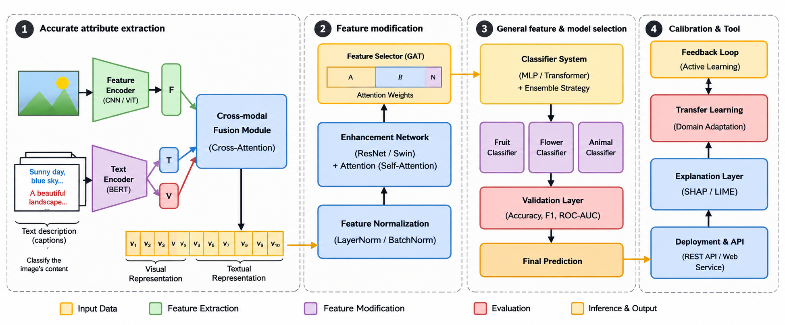

# ZEN-IQA: Zero-Shot, Explainable No-Reference Image Quality Assessment

ZEN-IQA predicts the perceived quality of a photo **without a reference image and without training a deep network**. It asks a frozen CLIP model (ResNet-50 backbone) how well an image matches pairs of opposite text prompts, such as "sharp photo" vs. "blurred photo". The answers become interpretable attribute scores that are combined into one quality score.

The project is built on [MMEditing](https://github.com/open-mmlab/mmediting) (`mmedit` 0.16.1) and evaluated on the **KonIQ-10k** dataset.

<!-- Images -> https://database.mmsp-kn.de/koniq-10k-database.html -->
<!-- CSV -> https://www.kaggle.com/datasets/generalhawking/koniq-10k-dataset -->



## Overview

1. **Image encoder and text encoder (both frozen).** The image and each prompt are embedded with CLIP RN50.
2. **Antonym prompt pairs.** Each attribute has a positive and a negative prompt:

   | Attribute          | Positive prompt                 | Negative prompt                          |
   | ------------------ | ------------------------------- | ---------------------------------------- |
   | Sharpness (S)      | sharp photo, good photo.        | blurred photo, bad photo.                |
   | Noise (N)          | noiseless photo, good photo.    | noise photo, bad photo.                  |
   | Over-exposure (O)  | well exposed photo, good photo. | white out overexposed photo, bad photo.  |
   | Under-exposure (U) | well exposed photo, good photo. | black out underexposed photo, bad photo. |

3. **Cosine similarity and softmax** give a score in [0, 1] for each attribute.
4. **Aggregation.** The original zero-shot score is `(S + N + min(O, U)) / 3`.

This repository has three scoring variants:

| Variant                       | Script                      | What it does                                                                                                                                                                                                                                                                                                                                          |
| ----------------------------- | --------------------------- | ----------------------------------------------------------------------------------------------------------------------------------------------------------------------------------------------------------------------------------------------------------------------------------------------------------------------------------------------------- |
| **Zero-shot baseline**        | `demo/model.py`             | Uses the 4 attributes with the simple average above.                                                                                                                                                                                                                                                                                                  |
| **Exposure MLP**              | `demo/zeniqa_koniq_demo.py` | Trains a small MLP that maps (O, U) to an exposure score, then averages it with S and N.                                                                                                                                                                                                                                                              |
| **Improved (learned fusion)** | `demo/improved.py`          | Uses 12 zero-shot attributes (the original 4 plus overall quality, contrast, colorfulness, detail, artifacts, distortion and focus). Features are mapped to logit space. Ridge, MLP-ensemble and gradient-boosting regressors are compared on the validation split. The best one is refit on train+val and a 4-parameter logistic mapping is applied. |

**Result of the improved variant on the KonIQ-10k test split (2,015 images):** SRCC ≈ **0.841**, PLCC ≈ **0.863**. These values come from `zeniqa_improved_predictions.csv`.

## Project structure

```
.
├── configs/zeniqa/
│   ├── zeniqa_attribute_test.py        # 4-attribute (S, N, O, U) config
│   └── zeniqa_attribute_extended.py    # 12-attribute config for the improved model
├── demo/
│   ├── model.py                        # zero-shot evaluation
│   ├── zeniqa_koniq_demo.py            # exposure-MLP evaluation
│   ├── improved.py                     # improved learned-fusion pipeline
│   └── clipiqa_single_image_demo.py    # radar plot of attributes for one image
├── mmedit/                             # MMEditing library with the CLIP-IQA / ZEN-IQA code
├── create_small_dataset.py             # builds a small KonIQ subset for quick tests
├── attrs_cache.npz, checkpoints/       # cached attribute scores, so extraction runs only once
├── exposure_mlp.pth                    # trained exposure MLP weights
├── zeniqa_improved_predictions.csv     # test-set predictions (pred, raw, mos)
└── requirements/                       # dependency lists
```

## Download and installation

### 1. Get the code

```bash
git clone <YOUR-REPOSITORY-URL> zeniq
cd zeniq
```

If you received the project as a zip file, unzip it and `cd` into the folder instead.

### 2. Create an environment

Python 3.8 is recommended, because the project was developed with it. Python 3.7 to 3.10 are listed in `setup.py`.

```bash
conda create -n zeniq python=3.8 -y
conda activate zeniq
```

### 3. Install PyTorch

Pick the command for your CUDA version from <https://pytorch.org/get-started/locally/>. For example:

```bash
pip install torch torchvision
```

### 4. Install MMCV and the project

```bash
pip install -U openmim
mim install "mmcv-full>=1.3.17"

pip install -r requirements/runtime.txt
pip install pandas scipy scikit-learn tqdm plotly kaleido
pip install -e .
```

`pandas`, `scipy`, `scikit-learn`, `tqdm`, `plotly` and `kaleido` are imported by the demo scripts, but they are not listed in `requirements/`. That is why they are installed explicitly above.

### 5. Download the dataset (KonIQ-10k)

Download **KonIQ-10k** from <http://database.mmsp-kn.de/koniq-10k-database.html>. You need two things:

- the `1024x768` image folder
- `koniq10k_distributions_sets.csv` (columns include `image_name`, `MOS` and `set`)

Place them like this:

```
zeniq/
└── dataset/
    ├── 1024x768/                          # all images
    └── koniq10k_distributions_sets.csv
```

> **CLIP weights:** the first run downloads the CLIP `RN50.pt` weights automatically from OpenAI's servers, so you need an internet connection once.

## Usage

All commands are run from the project root.

### Zero-shot evaluation (original ZEN-IQA)

```bash
python demo/model.py \
    --file_path dataset/1024x768 \
    --csv_path dataset/koniq10k_distributions_sets.csv
```

This prints the SRCC and PLCC on the KonIQ test split.

### Exposure-MLP version

```bash
python demo/zeniqa_koniq_demo.py \
    --file_path dataset/1024x768 \
    --csv_path dataset/koniq10k_distributions_sets.csv
```

Useful options: `--mlp_epochs`, `--mlp_lr`, `--hidden_dim`, `--mlp_ckpt exposure_mlp.pth` and `--resume`. Add `--resume` to continue MLP training from the saved checkpoint.

### Improved version (learned fusion)

```bash
python demo/improved.py \
    --file_path dataset/1024x768 \
    --csv_path dataset/koniq10k_distributions_sets.csv
```

- The first run extracts attributes for every image. This is the slow part, and it saves progress in `checkpoints/` so it can resume after a crash.
- The extracted attributes are saved to `attrs_cache.npz`. **This file is included in the project**, so you can skip extraction and re-run instantly:

  ```bash
  python demo/improved.py --cache attrs_cache.npz
  ```

- Predictions are written to `zeniqa_improved_predictions.csv`.
- Quick debug run on a small number of images: `--max_per_split 100`.

### Quick test with a small dataset

`create_small_dataset.py` samples 2,000 training, 500 validation and 300 test images into `koniq_small.csv`:

```bash
python create_small_dataset.py
python demo/model.py --csv_path koniq_small.csv
```

### Attribute radar plot for a single image

```bash
python demo/clipiqa_single_image_demo.py --file_path path/to/image.jpg
```

This writes the plot to `test.svg`. Open the script first: it points to a `clipiqa` config and uses attribute labels (Aesthetic, Happy, Natural, …) that you may need to change to match the ZEN-IQA attributes.

### CPU instead of GPU

The default is GPU `0`. To run on CPU, change `torch.device(args.device)` / `--device` handling in the demo scripts to `'cpu'`. There is already a commented line for this in `demo/zeniqa_koniq_demo.py`.

## Troubleshooting

| Problem                                              | Fix                                                                                                 |
| ---------------------------------------------------- | --------------------------------------------------------------------------------------------------- |
| `not implemented for 'Half'` on CPU                  | The demos already call `model.float()`. Make sure you run them unmodified and on a recent checkout. |
| Config paths such as `/root/4T/dataset/koniq10k/...` | They only matter for training. Edit `img_folder` / `ann_file` in the config if you train.           |
| `ModuleNotFoundError: mmcv`                          | Re-run step 4 and make sure the `mmcv-full` build matches your PyTorch/CUDA version.                |
| `kaleido` errors in the radar-plot demo              | `pip install kaleido`.                                                                              |

## Acknowledgements

- [MMEditing](https://github.com/open-mmlab/mmediting) (OpenMMLab), the code base.
- [CLIP](https://github.com/openai/CLIP) (OpenAI), the frozen vision-language model.
- CLIP-IQA, the prompt-based quality assessment this project builds on.
- [KonIQ-10k](http://database.mmsp-kn.de/koniq-10k-database.html), the evaluation dataset.

## License

Released under the Apache 2.0 license (see `LICENSE`).
